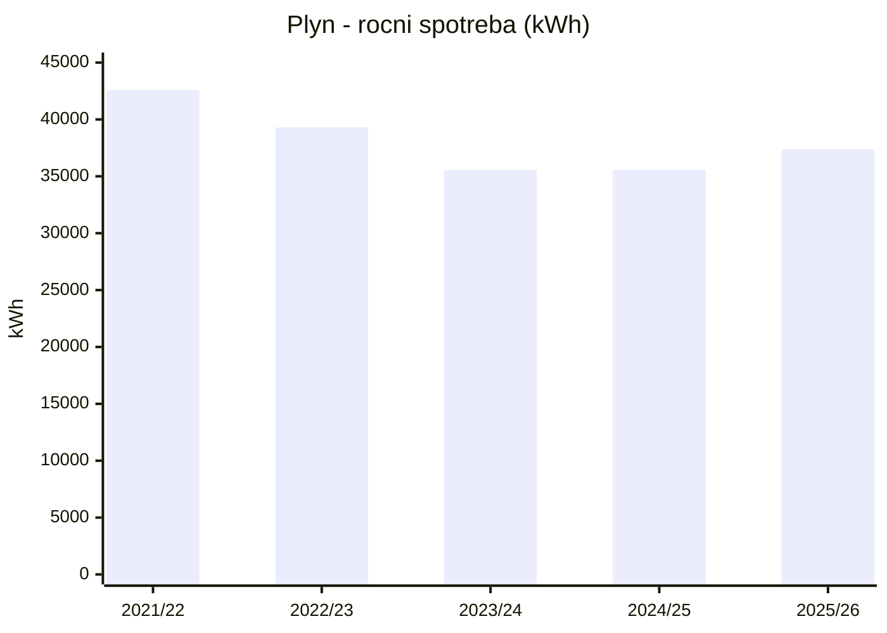
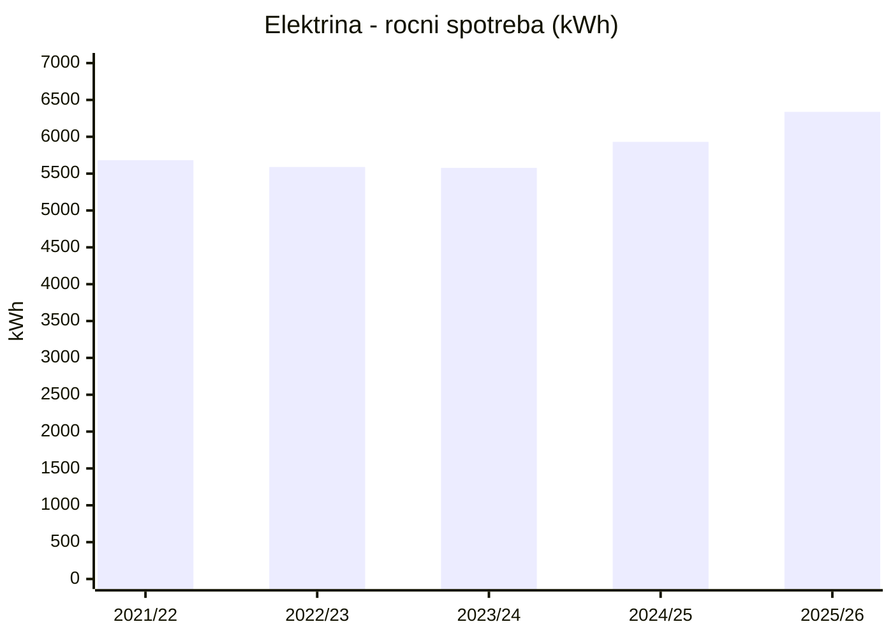

# Vyúčtování elektřiny a plynu

> Přepsáno ze **13 vyúčtování od innogy Energie, s.r.o.** (elektřina 7/2021 – 6/2026, plyn
> 8/2021 – 9/2026), stav k **14. 10. 2026**. Každé vyúčtování má vlastní stránku s kompletním
> přepisem (odečty, ceny po obdobích, zálohy) — odkazy v tabulkách níže. Originální PDF jsou
> jen v soukromé složce, do repa nepatří (osobní údaje).

## Souhrn — co z vyúčtování plyne

| Ukazatel | Elektřina | Plyn |
|----------|-----------|------|
| **Roční spotřeba** (poslední celý rok) | **6 338 kWh** (27. 6. 2025 – 22. 6. 2026; VT 4 672 / NT 1 666) | **37 388 kWh** (4. 9. 2025 – 6. 9. 2026; 3 333 m³ naměřeno) |
| Roční spotřeba (rozpětí 2021–2026) | 5 578 – 6 338 kWh, mírně roste | 35 528 – 42 567 kWh |
| **Roční náklad vč. DPH** (poslední rok) | **≈ 42 580 Kč** | **≈ 64 850 Kč** |
| **Průměrně za měsíc** (poslední rok) | **≈ 3 550 Kč/měs.** | **≈ 5 400 Kč/měs.** |
| Průměrná cena vč. DPH a stálých plateb | ≈ 6,72 Kč/kWh | ≈ 1,73 Kč/kWh |
| Aktuální záloha | 3 310 Kč/měs. (od 7/2026) | 4 720 Kč/měs. (od 10/2026) |
| Tarif | sazba **D25d** (dvoutarif, „Aku 8“ = 8 h NT), jistič **3 × 20 A** | třída TDD **DOM4** |
| Produkt | **elektřina Optimal 36** | **plyn Optimal 36** |
| Cena komodity 2026 (bez DPH) | **2 940 Kč/MWh** (VT = NT), stálý plat 127 Kč/měs., sleva 10 % z komodity | **1,23 Kč/kWh**, stálý plat 130 Kč/měs., sleva 20 % z komodity |
| **Fixace / závazek** | do **15. 11. 2027** (změna ceny od 16. 11. 2027) | do **15. 11. 2027** (změna ceny od 16. 11. 2027) |
| Dodavatel | innogy Energie, s.r.o. | innogy Energie, s.r.o. |

**Energie celkem za poslední rok ≈ 107 000 Kč vč. DPH** (elektřina ~42,6 tis. + plyn ~64,8 tis.)
→ to je základ pro výpočet úspor v [modelu](../05-model/index.html).

> ℹ️ „Sleva z platby za spotřebu“ na dokladech od 12/2024 vychází přesně na **10 % ceny silové
> elektřiny** a **20 % ceny plynu (komodity)** — dopočteno z dokladů, dodavatel to výslovně neuvádí.

## Vývoj roční spotřeby
{: #vyvoj-spotreby}

Roky podle zúčtovacích období: elektřina červen–červen, plyn září–září. Změna = proti předchozímu roku.

| Rok | Elektřina (kWh) | Změna | Plyn (kWh) | Změna | Elektřina (Kč) | Změna | Plyn (Kč) | Změna |
|-----|----------------:|------:|-----------:|------:|---------------:|------:|----------:|------:|
| 2021/22 | 5 682 | — | 42 567 | — | 25 474 | — | 52 394 | — |
| 2022/23 | 5 590 | ▼ −1,6 % | 39 299 | ▼ −7,7 % | 23 117 | ▼ −9,3 % | 86 455 | ▲ +65,0 % |
| 2023/24 | 5 578 | ▼ −0,2 % | 35 528 | ▼ −9,6 % | 41 334 | ▲ +78,8 % | 103 139 | ▲ +19,3 % |
| 2024/25 | 5 931 | ▲ +6,3 % | 35 579 | ▲ +0,1 % | 47 185 | ▲ +14,2 % | 75 505 | ▼ −26,8 % |
| 2025/26 | 6 338 | ▲ +6,9 % | 37 388 | ▲ +5,1 % | 42 580 | ▼ −9,8 % | 64 850 | ▼ −14,1 % |
| **2025/26 vs. 2021/22** | | **▲ +11,5 %** | | **▼ −12,2 %** | | **▲ +67,2 %** | | **▲ +23,8 %** |

**Co z toho plyne:** spotřeba **elektřiny** byla do roku 2023/24 stabilní (~5,6 MWh) a poslední dva roky
roste zhruba o 6–7 % ročně. Spotřeba **plynu** do 2023/24 klesala (−16,5 % za dva roky), od té doby mírně
roste. Náklady se hýbaly hlavně s cenami (konec fixací 2023, cenový strop), ne se spotřebou. Proč se
spotřeba mění, doklady neříkají (teploty zim ani změny v domácnosti v nich nejsou).

_Plyn 2024/25 a 2025/26 a elektřina 2025/26 jsou součty dvou navazujících dokladů. Plyn 2024/25 nezahrnuje
14.–15. 12. 2024 (jiný obchodník, ~27 m³)._

## Elektřina

| Období | Dní | VT (kWh) | NT (kWh) | Celkem (kWh) | Vč. DPH (Kč) | Kč/měs. | Kč/kWh | Výsledek | Detail |
|--------|----:|---------:|---------:|-------------:|-------------:|--------:|-------:|----------|--------|
| 2. 7. 2021 – 27. 6. 2022 | 361 | 4 255 | 1 427 | 5 682 | 25 473,87 | ≈ 2 148 | 4,48 | nedoplatek 6 973,87 | [2021/22](vyuctovani/elektrina_2021-07-02_2022-06-27_innogy_radne-vyuctovani.html) |
| 28. 6. 2022 – 23. 6. 2023 | 361 | 4 132 | 1 458 | 5 590 | 23 116,53 | ≈ 1 949 | 4,14 | přeplatek 1 233,47 | [2022/23](vyuctovani/elektrina_2022-06-28_2023-06-23_innogy_radne-vyuctovani.html) |
| 24. 6. 2023 – 24. 6. 2024 | 367 | 4 076 | 1 502 | 5 578 | 41 334,45 | ≈ 3 428 | 7,41 | nedoplatek 734,45 | [2023/24](vyuctovani/elektrina_2023-06-24_2024-06-24_innogy_radne-vyuctovani.html) |
| 25. 6. 2024 – 26. 6. 2025 | 367 | 4 435 | 1 496 | 5 931 | 47 185,35 | ≈ 3 913 | 7,96 | nedoplatek 3 325,35 | [2024/25](vyuctovani/elektrina_2024-06-25_2025-06-26_innogy_radne-vyuctovani.html) |
| 27. 6. 2025 – 31. 12. 2025 _(mimořádné)_ | 188 | 2 461 | 890 | 3 351 | 23 723,50 | ≈ 3 841 | 7,08 | nedoplatek 2 603,50 | [7–12/2025](vyuctovani/elektrina_2025-06-27_2025-12-31_innogy_mimoradne-vyuctovani.html) |
| 1. 1. 2026 – 22. 6. 2026 | 173 | 2 211 | 776 | 2 987 | 18 856,36 | ≈ 3 318 | 6,31 | přeplatek 2 683,64 | [1–6/2026](vyuctovani/elektrina_2026-01-01_2026-06-22_innogy_radne-vyuctovani.html) |

**Vývoj ceny silové elektřiny (bez DPH):** 1 468 Kč/MWh (2021) → 1 401 Kč/MWh (do 15. 10. 2023,
konec staré fixace) → **4 600 / 4 350 Kč/MWh** (produkt Start24, 10/2023 – 11/2024) → **3 150 Kč/MWh**
(Optimal 36, od 12/2024) → **2 940 Kč/MWh** (2026). V roce 2026 se navíc neplatí poplatek za OZE.

## Plyn

| Období | Dní | m³ | kWh | Vč. DPH (Kč) | Kč/měs. | Kč/kWh | Výsledek | Detail |
|--------|----:|---:|----:|-------------:|--------:|-------:|----------|--------|
| 28. 8. 2021 – 10. 9. 2022 | 379 | 3 883 | 42 567 | 52 393,54 | ≈ 4 208 | 1,23 | nedoplatek 29 761,54 | [2021/22](vyuctovani/plyn_2021-08-28_2022-09-10_innogy_radne-vyuctovani.html) |
| 11. 9. 2022 – 4. 9. 2023 | 359 | 3 527 | 39 299 | 86 455,26 | ≈ 7 330 | 2,20 | nedoplatek 31 692,26 | [2022/23](vyuctovani/plyn_2022-09-11_2023-09-04_innogy_radne-vyuctovani.html) |
| 5. 9. 2023 – 7. 9. 2024 | 369 | 3 208 | 35 528 | 103 139,21 | ≈ 8 508 | 2,90 | přeplatek 13 250,79 | [2023/24](vyuctovani/plyn_2023-09-05_2024-09-07_innogy_radne-vyuctovani.html) |
| 8. 9. 2024 – 13. 12. 2024 _(mimořádné)_ | 97 | 1 041 | 11 529 | 31 220,70 | — | 2,71 | 0,00 | [9–12/2024](vyuctovani/plyn_2024-09-08_2024-12-15_innogy_mimoradne-vyuctovani.html) |
| 16. 12. 2024 – 3. 9. 2025 | 262 | 2 159 | 24 050 | 44 284,76 | — | 1,84 | přeplatek 16 174,54 | [12/2024–9/2025](vyuctovani/plyn_2024-12-16_2025-09-03_innogy_radne-vyuctovani.html) |
| 4. 9. 2025 – 31. 12. 2025 _(mimořádné)_ | 119 | 1 339 | 14 977 | 25 683,31 | — | 1,71 | nedoplatek 5 613,31 | [9–12/2025](vyuctovani/plyn_2025-09-04_2025-12-31_innogy_mimoradne-vyuctovani.html) |
| 1. 1. 2026 – 6. 9. 2026 | 249 | 1 994 | 22 412 | 39 166,54 | — | 1,75 | nedoplatek 606,54 | [1–9/2026](vyuctovani/plyn_2026-01-01_2026-09-06_innogy_radne-vyuctovani.html) |

_U kratších období plynu měsíční průměr neuvádím — závisí na tom, kolik zimy období obsahuje (viz roční přehled)._

**Vývoj ceny plynu (komodita, bez DPH):** 0,745 Kč/kWh (Benefit+, do 31. 1. 2023) → **2,50 Kč/kWh**
(státní strop, 2/2023 – 12/2023) → 1,87 Kč/kWh (Start 12, od 13. 12. 2023) → 1,285 Kč/kWh
(Optimal 36, 2025) → **1,23 Kč/kWh** (2026). Distribuce mezitím zdražila z 0,172 na 0,284 Kč/kWh
a kapacitní složka ze 195 na 339 Kč/měs.

> ⚠️ **Mezera 14.–15. 12. 2024:** innogy dočasně přerušila dodávku (výpověď dle energetického zákona)
> a několik dní dodával jiný obchodník. Jeho vyúčtování mezi podklady **není** (spotřeba ~27 m³,
> řádově stovky Kč — pro model zanedbatelné).

## Roční přehled (pro model)

Elektřina se účtuje červen–červen, plyn září–září. Rok 2024/25 a 2025/26 je složený ze dvou dokladů.

| Rok | Elektřina (kWh) | Elektřina (Kč) | Plyn (kWh) | Plyn (Kč) | Energie celkem (Kč) | Poznámka |
|-----|----------------:|---------------:|-----------:|----------:|--------------------:|----------|
| 2021/22 | 5 682 | 25 474 | 42 567 | 52 394 | 77 868 | staré fixace, levné ceny |
| 2022/23 | 5 590 | 23 117 | 39 299 | 86 455 | 109 572 | plyn od 2/2023 na stropu 2,50 Kč/kWh; elektřina se státním příspěvkem 3 500 Kč |
| 2023/24 | 5 578 | 41 334 | 35 528 | 103 139 | 144 473 | nejdražší rok (konec fixací, strop) |
| 2024/25 | 5 931 | 47 185 | 35 579 | 75 505 | 122 691 | plyn = 2 doklady innogy; bez dokladu jiného obchodníka za 14.–15. 12. 2024 |
| **2025/26** | **6 338** | **42 580** | **37 388** | **64 850** | **107 430** | aktuální ceny Optimal 36 (fixace do 11/2027) |

## Ceny pro model úspor (stav 2026)
{: #ceny-pro-model}

Pro výpočet, kolik ušetří **každá ušetřená kWh**, se hodí mezní cena (jen proměnné složky),
ne průměr se stálými platbami. Dopočteno z cen ve vyúčtováních 2026 (bez DPH × 1,21):

| Energie | Proměnná cena vč. DPH | Stálé platby vč. DPH | Výpočet |
|---------|----------------------:|---------------------:|---------|
| Elektřina VT | **≈ 6,16 Kč/kWh** | ≈ 429 Kč/měs. (distribuce 215 + dodávka 127 + nesíťová infrastruktura 12,87 Kč bez DPH) | komodita 2 940 × 0,9 (sleva) + distribuce VT 2 252,45 + systémové služby 164,24 + daň 28,30 Kč/MWh |
| Elektřina NT | **≈ 3,58 Kč/kWh** | (v ceně výše) | komodita 2 646 + distribuce NT 116,50 + 164,24 + 28,30 Kč/MWh |
| Elektřina vážený průměr (NT 26 %) | ≈ 5,48 Kč/kWh | | |
| Plyn | **≈ 1,54 Kč/kWh** | ≈ 568 Kč/měs. (kapacitní složka distribuce 339,41 + stálý plat 130 Kč bez DPH) | komodita 1,23 × 0,8 (sleva) + distribuce 0,28449 + OTE 0,00406 Kč/kWh |

> Ceny platí do **15. 11. 2027**; potom podle nové nabídky. Stálé platby za plyn zůstanou, dokud
> dům plyn odebírá (i při malé spotřebě).

## Na co se spotřeba dělí (z měsíčních údajů o plynu)

Vyúčtování plynu rozpisují spotřebu po měsících (detail na stránkách jednotlivých dokladů).
V létě (červen–srpen) je spotřeba jen **~120–400 kWh/měs.**, v zimě 6–8,6 MWh/měs.

| Spotřebič | Energie | Odhad kWh/rok | Poznámka |
|-----------|---------|--------------:|----------|
| Vytápění | plyn | ≈ 32 500 – 34 500 | roční spotřeba minus letní základ — **odhad** |
| Ohřev vody + vaření | plyn | ≈ 3 000 | letní základ ~250 kWh/měs. × 12 — **odhad** (předpoklad: TUV ohřívá plynový kotel) |
| Domácnost (spotřebiče, světla) | elektřina | ≈ 5 600 – 6 300 | skutečnost z vyúčtování; NT ~26 % |
| Elektromobil (plán) | elektřina | | 25 000 km/rok → viz [Rešerše, bod 12](../reserse-nzu-2026.html) |

### Měsíční spotřeba plynu (kWh)

| Měsíc | 2021/22 | 2022/23 | 2023/24 | 2024/25 | 2025/26 |
|-------|--------:|--------:|--------:|--------:|--------:|
| září | 670 | 1 301 | 377 | 676 | 637 |
| říjen | 3 151 | 1 749 | 1 506 | 2 149 | 2 785 |
| listopad | 5 468 | 4 914 | 4 696 | 5 748 | 5 201 |
| prosinec | 7 653 | 7 399 | 6 501 | 7 680* | 6 375 |
| leden | 7 171 | 6 451 | 8 627 | 5 960 | 7 744 |
| únor | 5 932 | 6 307 | 5 039 | 5 715 | 5 642 |
| březen | 6 469 | 5 326 | 4 519 | 3 910 | 4 305 |
| duben | 4 313 | 4 078 | 2 669 | 1 749 | 2 787 |
| květen | 766 | 1 226 | 687 | 1 259 | 967 |
| červen | 274 | 290 | 399 | 256 | 371 |
| červenec | 241 | 123 | 266 | 234 | 270 |
| srpen | 197 | 212 | 255 | 278 | 259 |

_Kalendářní měsíce sečtené z rozpisu distribuce ve všech dokladech. Odečty jsou jen několikrát ročně,
na měsíce spotřebu rozpočítává distributor podle typového diagramu (TDD) — nejde o skutečné měsíční
odečty. Proto se součet sloupce nemusí přesně shodovat s ročním dokladem (např. září 2022 obsahuje
i 142 kWh z dokladu 2021/22; spotřeba 28.–31. 8. 2021, 121 kWh, v tabulce není). *Bez 14.–16. 12. 2024
(jiný obchodník)._

## Poznámky

- Od 2023 spotřeba plynu klesla z ~42,6 MWh na ~35,5 MWh (vliv vysokých cen / úsporného chování,
  teplotu jednotlivých zim doklady neuvádějí); 2025/26 zase mírně vzrostla na 37,4 MWh.
- Elektřina mírně roste (5,6 → 6,3 MWh/rok).
- Dva „mimořádné“ doklady k 31. 12. 2025 (elektřina i plyn) důvod neuvádějí — pravděpodobně uzavření
  roku před změnou regulovaných cen 2026 (odhad).
